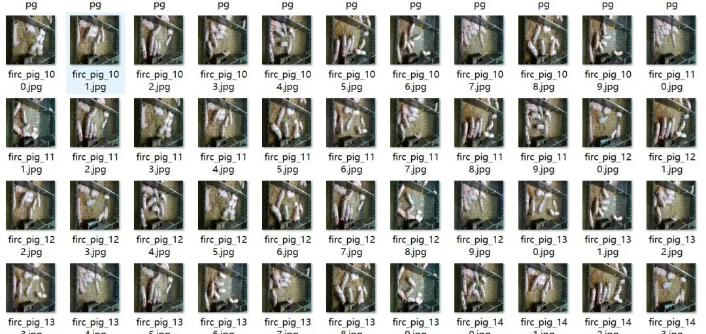
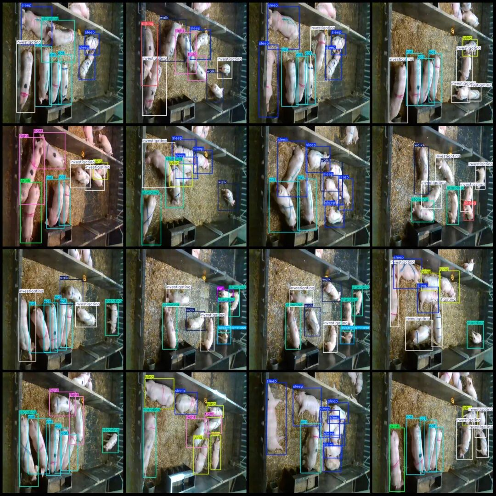

# Intelligent Livestock - Pig Farm Behavioral State Detection Dataset VOC+YOLO format with 3790 images in 15 categories

Dataset format: Pascal VOC format + YOLO format (txt file without split path, only containing jpg images and corresponding VOC format xml files and yolo format txt files)

Number of images (number of jpg files): 3790

Number of annotations (number of xml files): 3790

Number of annotations (number of txt files): 3790

Label category count: 15

Label category names (note that the order of categories in the YOLO format does not correspond to this, but is based on the labels folder's classes.txt): ["drink", "eat", "fight", "investigating", "jump on top of", "lying", "nose-poke-elsewhere", "nose-to-nose", "other", "play with toy", "run", "sitting", "sleep", "standing", "walk"]

Number of boxes labeled in each category:

drink Frames = 409

Number of "eat" boxes = 3738

Fight Frames = 506

Investigating Frame Count = 6915

Jump on top of the frame = 6

Number of frames = 2760

Nose-poke-elsewhere frame count = 43

Nose-to-nose frame count = 551

Other frame count = 2

Play with toy Frames = 92

Number of runs = 108

Number of sittings = 394

Sleep Frames = 8356

Number of standing frames = 3783

Walk Frames = 2559

Total frame count: 30222

Using labelImg:

Annotation rules: Draw a rectangle around the category.

Important Notice: No

Special : This dataset does not guarantee the accuracy or precision of the trained models or weight files. The dataset is provided with accurate and reasonable annotations only.

Image Preview:

Annotation example:

## Payment

Here is a pay link on Stripe ( https://buy.stripe.com/3cs8yP7sY87d0vu9AB ). Please contact me lonlonago@foxmail.com after funding $89, and I will send you a complete data files , thank you!

